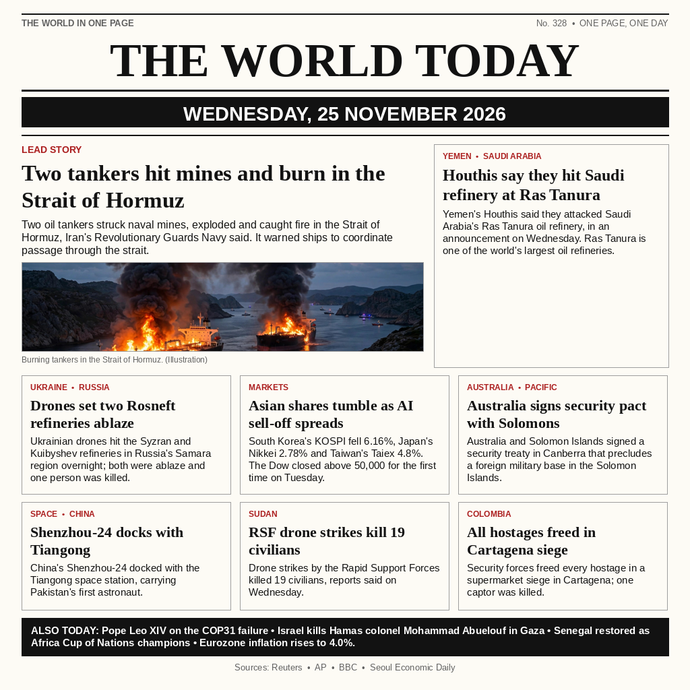

[](https://make.fun/bounty/news-image-20261125?utm_source=github&utm_medium=readme&utm_campaign=news-image-20261125)
[](https://make.fun/bounty/news-image-20261125/leaderboard?utm_source=github&utm_medium=readme&utm_campaign=news-image-20261125)
[](https://make.fun/bounty/news-image-20261125?utm_source=github&utm_medium=readme&utm_campaign=news-image-20261125)

# The World in One Page — Wednesday, 25 November 2026

One newspaper front page that sums up the world's news of **Wednesday, 25 November 2026**. Every story on the page was reported on that day; nothing from 24 November or any earlier day is presented as the day's news.



## How it is built

The image is a 1024 × 1024 PNG, drawn by `tools/generate_image.py` (Python + Pillow, using the system Liberation fonts). The lead photograph — two tankers burning in the Strait of Hormuz — was generated as an illustration for this entry and is cropped into the lead slot by the script; the masthead, date band, headlines and story panels are all drawn as text, so every word stays sharp and legible. `main.ts` (Node 22, standard library only) simply copies `entry.png` into the output directory given by `MAKEFUN_OUTPUT_DIR` (default `/output`, with the source looked up under `MAKEFUN_BOT_DIR`), then reads the copy back to confirm it is byte-identical and still a 1024 × 1024 PNG under 1 MiB.

To rebuild the image:

```sh
python3 tools/generate_image.py
```

To run the entry:

```sh
mkdir -p out && MAKEFUN_OUTPUT_DIR=out node main.ts
```

## Stories on the page

| # | Story | What the page says |
|---|-------|--------------------|
| 1 | **Lead — Two tankers hit mines in the Strait of Hormuz** | Two oil tankers struck naval mines, exploded and caught fire in the Strait of Hormuz, Iran's Revolutionary Guards Navy said. It warned ships to coordinate passage through the strait. |
| 2 | **Houthis say they hit Saudi refinery at Ras Tanura** | Yemen's Houthis said they attacked Saudi Arabia's Ras Tanura oil refinery, in an announcement on Wednesday. |
| 3 | **Drones set two Rosneft refineries ablaze** | Ukrainian drones hit the Syzran and Kuibyshev refineries in Russia's Samara region overnight; both were ablaze and one person was killed. |
| 4 | **Asian shares tumble** | South Korea's KOSPI fell 6.16%, Japan's Nikkei 2.78% and Taiwan's Taiex 4.8% as the AI sell-off spread. The Dow closed above 50,000 for the first time on Tuesday. |
| 5 | **Australia signs security pact with Solomons** | Australia and Solomon Islands signed a security treaty in Canberra that precludes a foreign military base in the Solomon Islands. |
| 6 | **Shenzhou-24 docks with Tiangong** | China's Shenzhou-24 docked with the Tiangong space station, carrying Pakistan's first astronaut. |
| 7 | **RSF drone strikes kill 19 civilians in Sudan** | Drone strikes by the Rapid Support Forces killed 19 civilians, reports said on Wednesday. |
| 8 | **All hostages freed in Cartagena siege** | Security forces freed every hostage in a supermarket siege in Cartagena, Colombia; one captor was killed. |
| — | **Also today** | Pope Leo XIV on the COP31 failure; Israel kills Hamas colonel Mohammad Abuelouf in Gaza; Senegal restored as Africa Cup of Nations champions; eurozone inflation rises to 4.0%. |

## Sources

Reuters, AP, BBC, Seoul Economic Daily.

## Notes on accuracy

- The lead photograph is an illustration, labelled as such on the page — it is not presented as a photograph of the actual incident.
- Wording sticks to what was reported on the day: claims are attributed to whoever made them (the IRGC, the Houthis), and no story from another day is borrowed — the Houthi Riyadh tower strike, the Huawei verdict, Dell's results and the COP31 collapse itself all belong to other days and are left out.

---

Built for the [make.fun](https://make.fun?ref=kwb58z1j) bounty "Sum up 25 November's world news in one image" (news-image-20261125).
